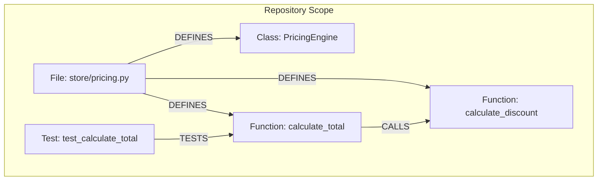

# DevGraph AI — Code Intelligence & Architecture Investigation Platform

DevGraph AI is an enterprise-grade, graph-native code intelligence, debugging, and architectural investigation platform. It translates codebases into an interactive **AST knowledge graph** in [FalkorDB](https://www.falkordb.com/), runs automated tests with graph-linked failure root-cause analysis, proposes validated diff patches, and provides deep semantic reasoning powered by **Google Gemini 2.5**.

---

## 📑 Table of Contents
1. [Architecture Overview](#architecture-overview)
2. [Prerequisites](#prerequisites)
3. [Setup & Quick Start Instructions](#setup--quick-start-instructions)
   - [1. Start FalkorDB](#1-start-falkordb)
   - [2. Configure Environment & Gemini API Key](#2-configure-environment--gemini-api-key)
   - [3. Start the FastAPI Backend](#3-start-the-fastapi-backend)
   - [4. Start the Vite React Frontend](#4-start-the-vite-react-frontend)
4. [Graph Data Model](#graph-data-model)
   - [Entities & Node Labels](#entities--node-labels)
   - [Relationships & Edges](#relationships--edges)
   - [Entity Properties Reference](#entity-properties-reference)
   - [Graph Schema Diagram](#graph-schema-diagram)
5. [Core Cypher Queries & Graph Algorithms](#core-cypher-queries--graph-algorithms)
   - [1. Ingestion, Merging & Re-indexing](#1-ingestion-merging--re-indexing)
   - [2. Reconciling & Pruning Stale AST Entities](#2-reconciling--pruning-stale-ast-entities)
   - [3. Multi-Tenant Isolated Subgraph Extraction](#3-multi-tenant-isolated-subgraph-extraction)
   - [4. Variable-Depth Dependency Traversal & Blast Radius (BFS)](#4-variable-depth-dependency-traversal--blast-radius-bfs)
   - [5. Test-to-AST Failure Enrichment & Call Chain Resolution](#5-test-to-ast-failure-enrichment--call-chain-resolution)
   - [6. Architectural Hubs & Degree Centrality](#6-architectural-hubs--degree-centrality)
   - [7. Safe Cascade Deletion (Zero Ghost Data)](#7-safe-cascade-deletion-zero-ghost-data)
   - [8. Gemini 2.5 Semantic Graph Copilot](#8-gemini-25-semantic-graph-copilot)
6. [Interactive Features Guide](#interactive-features-guide)
7. [Running the Test Suite](#running-the-test-suite)
8. [License](#license)

---

## Architecture Overview

```
                      +---------------------------------------+
                      |       React 18 + Vite Frontend        |
                      |  - Cytoscape Interactive Graph Visual |
                      |  - Light / Dark Theme Switching       |
                      |  - In-App Gemini Key Configuration    |
                      |  - Repositories & History Manager     |
                      +-------------------+-------------------+
                                          | HTTP / REST
                                          v
                      +---------------------------------------+
                      |        FastAPI Backend Service        |
                      |  - Python Standard AST Parser Engine  |
                      |  - Pytest / JUnit Test Execution      |
                      |  - Multi-Tenant Repository Manager    |
                      |  - Strict Safe-Path Sandboxing        |
                      +---------+-------------------+---------+
                                |                   |
                 Cypher Queries |                   | Prompt & Evidence
                                v                   v
                +-------------------+   +-----------------------+
                | FalkorDB (Redis)  |   | Google Gemini 2.5     |
                | Graph Database    |   | AI Copilot & Root-    |
                | (Docker Container)|   | Cause Reasoner        |
                +-------------------+   +-----------------------+
```

---

## Prerequisites

Before starting DevGraph AI, ensure you have installed:
- **Docker Desktop** (for running the FalkorDB instance)
- **Python 3.11+**
- **Node.js 18+** & `npm`
- *(Optional)* Free **Google Gemini API Key** from [Google AI Studio](https://aistudio.google.com/)

---

## Setup & Quick Start Instructions

### 1. Start FalkorDB

DevGraph AI uses FalkorDB as its primary low-latency graph engine. Launch the official container from the repository root:

```powershell
# In Windows PowerShell or Bash:
docker compose up -d
```

Verify FalkorDB is running on port `6379`:
```powershell
docker ps
```

---

### 2. Configure Environment & Gemini API Key

You can configure your **Google Gemini API Key** in two ways:

#### Option A: In the Frontend UI (No text editing required)
Launch the application and click the **"⚡ Setup Gemini Key"** badge in the top-right header of any workspace page. Paste your key and click **Save Key**. The backend automatically tests and syncs it.

#### Option B: Via `backend/.env`
Copy the example file to `.env`:
```powershell
copy backend\.env.example backend\.env
```
Open `backend\.env` and configure:
```dotenv
GEMINI_API_KEY=your_actual_gemini_api_key_here
LLM_PROVIDER=gemini
LLM_MODEL=gemini-2.5-flash
LLM_BASE_URL=https://generativelanguage.googleapis.com/v1beta
LLM_TIMEOUT_SECONDS=30
FALKORDB_HOST=localhost
FALKORDB_PORT=6379
FALKORDB_GRAPH=devgraph
```

> **Security Note:** Your Gemini API key is processed exclusively on the server and is never exposed to the client bundle. If no key is set, the application operates gracefully in deterministic **Evidence-Only Mode**.

---

### 3. Start the FastAPI Backend

Install Python dependencies:
```powershell
python -m pip install -r backend\requirements.txt
```

Launch the FastAPI development server:
```powershell
python -m uvicorn backend.main:app --reload --port 8000
```

Verify backend health and database connectivity:
```powershell
curl http://localhost:8000/health
curl http://localhost:8000/ready
```

---

### 4. Start the Vite React Frontend

In a separate terminal:
```powershell
npm install
npm run dev
```

Open your browser at:
👉 **`http://localhost:5173`**

---

## Graph Data Model

DevGraph AI models repositories as deterministic Abstract Syntax Tree (AST) subgraphs. Every code element is parsed using Python's standard `ast` library into strongly typed nodes and directional relationships.

### Entities & Node Labels

| Node Label | Description | Primary Key / ID Format |
|:---|:---|:---|
| `:Repository` | The top-level project container holding metadata, file counts, and AST summary. | Hash (e.g. `9a1d565ca7984d17bc3a586cb6e86383`) |
| `:File` | A physical source code file in the repository. | `file:{repo_id}:{relative_path}` |
| `:Class` | A class declaration within a file. | `class:{repo_id}:{relative_path}:{ClassName}` |
| `:Function` | A standalone function or class method. | `func:{repo_id}:{relative_path}:{fn_name}` |
| `:Test` | A recognized test function or test case (e.g., `test_*`). | `test:{repo_id}:{relative_path}:{test_name}` |

---

### Relationships & Edges

| Relationship Type | Source Node | Target Node | Semantics |
|:---|:---|:---|:---|
| `[:DEFINES]` | `:File` | `:Class` or `:Function` | The file physically contains the definition of this symbol. |
| `[:CALLS]` | `:Function` | `:Function` | Static AST call invocation from caller to callee. |
| `[:TESTS]` | `:Test` | `:Function` | Explicit invocation of a production function by a test case. |

---

### Entity Properties Reference

- **`:File`**:
  - `id`: Unique stable identifier
  - `path` / `relative_path`: Normalized relative file path (e.g., `store/pricing.py`)
  - `language`: Source language (`python`)
  - `repository_id`: Scoped repository identifier
- **`:Function` / `:Class`**:
  - `id`: Stable identifier
  - `name`: Local symbol name (e.g., `calculate_tax`)
  - `qualified_name`: Fully qualified dotted path (e.g., `store.pricing.calculate_tax`)
  - `file_path`: Relative path of containing file
  - `start_line` & `end_line`: 1-indexed source line numbers
  - `repository_id`: Scoped repository identifier
- **`:Test`**:
  - `id`: Unique test node identifier
  - `name`: Dotted or pytest invocation path
  - `file_path`: Path to test suite file
  - `start_line` & `end_line`: Line boundary
  - `repository_id`: Scoped repository identifier

---

### Graph Schema Diagram



---

## Core Cypher Queries & Graph Algorithms

DevGraph AI executes structured Cypher queries against FalkorDB. Below are the core queries and graph algorithms powering the platform.

### 1. Ingestion, Merging & Re-indexing
During repository upload or reindexing, the AST parser extracts all code entities and upserts them idempotently using `MERGE`:

```cypher
// Upsert File Node
MERGE (f:File {id: $id})
SET f.path = $path,
    f.relative_path = $path,
    f.language = 'python',
    f.repository_id = $repository_id;

// Upsert Function Node
MERGE (n:Function {id: $id})
SET n.name = $name,
    n.qualified_name = $qualified_name,
    n.file_path = $file_path,
    n.start_line = $start_line,
    n.end_line = $end_line,
    n.repository_id = $repository_id;

// Link File to Function
MATCH (f:File {id: $file_id}), (n {id: $symbol_id})
MERGE (f)-[:DEFINES]->(n);

// Link Caller to Callee
MATCH (source:Function {id: $source_id}), (target:Function {id: $target_id})
MERGE (source)-[:CALLS]->(target);

// Link Test to Target Function
MATCH (test:Test {id: $test_id}), (target:Function {id: $target_id})
MERGE (test)-[:TESTS]->(target);
```

---

### 2. Reconciling & Pruning Stale AST Entities
When files or functions are renamed or removed, DevGraph AI reconciles the graph without dropping unchanged nodes:

```cypher
// 1. Delete incoming and outgoing relationships of stale entities
MATCH (n)-[r]->()
WHERE n.repository_id = $repository_id AND n.id IN $stale_ids
DELETE r;

MATCH ()-[r]->(n)
WHERE n.repository_id = $repository_id AND n.id IN $stale_ids
DELETE r;

// 2. Delete stale nodes
MATCH (n)
WHERE n.repository_id = $repository_id AND n.id IN $stale_ids
DELETE n;
```

---

### 3. Multi-Tenant Isolated Subgraph Extraction
Powers the **Graph Explorer** view. Strictly prevents ghost data by filtering elements to the selected active repository:

```cypher
MATCH (n)
WHERE $repository_id IS NULL OR n.repository_id = $repository_id
WITH n LIMIT $limit
OPTIONAL MATCH (n)-[r]->(m)
WHERE $repository_id IS NULL OR m.repository_id = $repository_id
RETURN n, r, m;
```

---

### 4. Variable-Depth Dependency Traversal & Blast Radius (BFS)
Calculates the transitive blast radius when a developer investigates an issue or proposes a code patch:

```cypher
MATCH path = (start)-[*1..$max_depth]->(connected)
WHERE (toString(id(start)) = $node_id OR start.id = $node_id)
  AND start.repository_id = $repository_id
WITH path LIMIT $limit
RETURN path;
```
*Algorithm Explanation:* This performs a bounded Breadth-First Search (BFS) starting at `start` up to depth `$max_depth` (default 3), discovering all downstream functions, classes, and tests affected by a modification.

---

### 5. Test-to-AST Failure Enrichment & Call Chain Resolution
When a test fails during a test run, DevGraph AI connects the runtime stack trace directly to the graph AST to find what was being tested and what secondary functions were called:

```cypher
MATCH (t:Test)
WHERE t.repository_id = $repo_id
  AND (t.name = $test_name 
       OR t.name ENDS WITH ('.' + $test_name) 
       OR t.name ENDS WITH ('::' + $test_name))
OPTIONAL MATCH (t)-[:TESTS]->(f:Function)
OPTIONAL MATCH (f)-[:CALLS]->(called:Function)
RETURN t, f, collect(DISTINCT called) AS called_functions
LIMIT 1;
```

---

### 6. Architectural Hubs & Degree Centrality
Discovers high-risk architectural bottlenecks and call hubs across the repository:

```cypher
MATCH (caller:Function)-[r:CALLS]->(callee:Function)
WHERE caller.repository_id = $repository_id
RETURN callee.name AS function_hub,
       callee.file_path AS file,
       count(r) AS in_degree
ORDER BY in_degree DESC
LIMIT 10;
```
*Algorithm Explanation:* Computes the **In-Degree Centrality** of functions within the repository. Functions with high in-degree are critical dependency hubs; any bug introduced in these nodes has high ripple probability.

---

### 7. Safe Cascade Deletion (Zero Ghost Data)
When a repository is deleted or reset, DevGraph AI performs a two-phase cascade delete:

```cypher
// Phase 1: Delete all relationships belonging to this repository
MATCH (source)-[r]->(target)
WHERE source.repository_id = $id OR target.repository_id = $id
DELETE r;

// Phase 2: Delete all isolated nodes belonging to this repository
MATCH (n)
WHERE n.repository_id = $id
DELETE n;
```

When 0 repositories remain in the system, a master wipe is triggered:
```cypher
MATCH (n) DETACH DELETE n;
```
This guarantees that **no ghost nodes, phantom tests, or orphaned investigations** linger across project switches.

---

### 8. Gemini 2.5 Semantic Graph Copilot
The **"✨ AI Architecture Copilot"** aggregates graph metrics (nodes, edges, entry points, central call hubs, test ratios) into structured evidence:

```json
{
  "repository": "sample_store",
  "total_ast_nodes": 42,
  "relationships": 38,
  "critical_hubs": ["calculate_total", "apply_discount"],
  "test_ratio": "0.6:1"
}
```

Google Gemini 2.5 flash evaluates the architecture and returns:
1. **Executive Architecture Overview**
2. **Critical Module Hubs & Why They Matter**
3. **Test Coverage Gaps & Blind Spots**
4. **Coupling Risks & Architectural Recommendations**

---

## Interactive Features Guide

| Feature | Location | What It Does |
|:---|:---|:---|
| **Repositories & History** | `#workspace/repositories` | Upload `.zip` codebases, switch between multiple projects with 1 click, or wipe workspace data. |
| **Interactive Graph Explorer** | `#workspace/graph` | Cytoscape visualizer with 4 layouts (**Force**, **Concentric**, **Tree Hierarchy**, **Circle**), node inspection, and AI Copilot. |
| **Test Runner & Results** | `#workspace/tests` | Runs repository pytest suites, displays pass/fail metrics, and runs **AI Failure Analysis** with variance calculation. |
| **Patch Review & Diff** | `#workspace/patches` | Displays syntax-highlighted git diffs, file change metrics, and 1-click clipboard diff copy. |
| **Bug Trace Investigations** | `#workspace/investigations` | Investigates bugs with evidence gathering and interactive technical Q&A chat. |
| **Theme Toggle** | Top Header | Seamless 1-click toggle between **Dark Mode** and **Light Mode**. |

---

## Running the Test Suite

DevGraph AI includes a comprehensive automated test suite covering all API routes, AST parsers, repository isolations, and deletion cascades:

```powershell
# Run the complete test suite
python -m pytest backend/tests

# Run with verbose output
python -m pytest backend/tests -v
```

All 32 core regression tests pass cleanly.

---

## License

MIT License. Built with FastAPI, React, Vite, FalkorDB, and Google Gemini AI.
